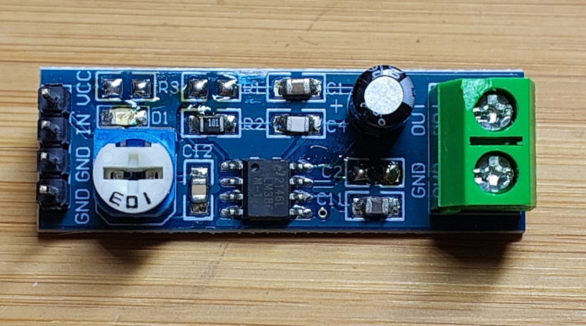
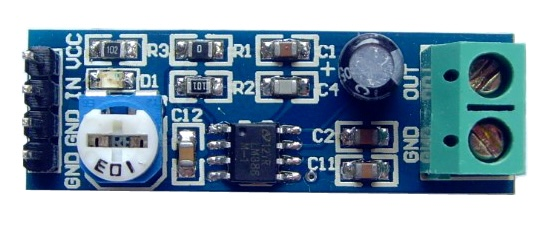
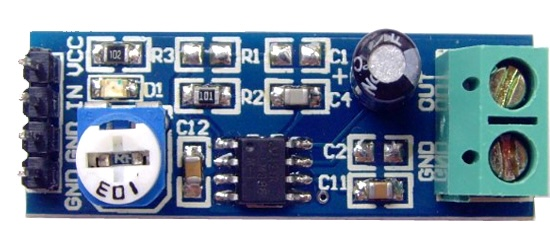
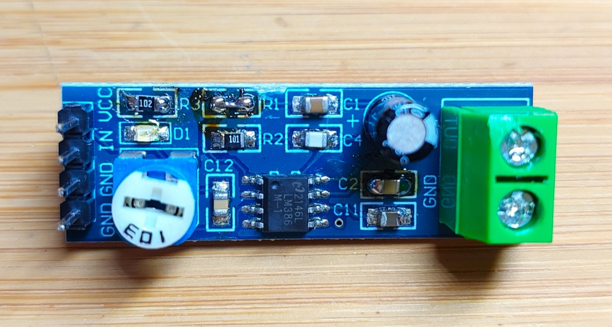

# #872 LM386 Module

Testing the LM386 amplifier module from LC Technology, made a little more interesting by a seller who appears to be trading in manufacturing rejects or training boards.

Here's a quick demo..

## Notes

Continuing my review of LM386-based amplifier circuits, I'm checking out an LM386-based, pre-fabricated module that I bought on aliexpress:
["ZUCZUG hot-selling newest 1pcs Adjustable LM386 Audio Amplifier Module 200 Times 5V-12V Input 10K Resistance" (aliexpress seller listing)](https://www.aliexpress.com/item/32305519267.html), purchased from Sky trading company ltd for S$1.14 (Nov-2021).

It is no longer available from this particular seller, but similar/same modules are widely available from other sellers e.g. [Realpoy Module Wholesale Store](https://www.aliexpress.com/item/1005009426806631.html).

Module specifications:

* Onboard LM386 Chip
* 200 times gain
* On-board speaker wiring Block
* On-board 10KΩ variable resistor for volume control
* On-board power indicator
* Pin headers for power and audio input
* Operating voltage: 5 ~ 12V
* Size: 41x13 mm

### Looking at the module ... hmm

A quick look at the board and it doesn't take long to find some issues and get a little suspicious!

* R3 is missing (so D1 LED won't light up)
* gain circuit is missing R1, so gain will be 20x not 200x
* C2 is missing: normally installed on 200x modules, but not installed on 20x modules
* .. and the output terminal block took a glancing blow from someone's iron!

So this module definitely looks like a manufacturing reject or training board.
Perhaps why the seller I used is no longer active!

I found the [manufacturers site](http://www.lctech-inc.com/) with details of the two boards:

* [LM386 20x Gain Power Amplifier Module](http://www.lctech-inc.com/cpzx/2/qtmk/2019/0116/369.html)
* [LM386 200x Gain Power Amplifier Module](http://www.lctech-inc.com/cpzx/2/gfmk/2019/0116/338.html)

The 200x module has R1, C1, and C2 populated:

The 20x module doesn't have R1, C1, and C2:

### Circuit Design

I've drawn the circuit with Fritzing: see [LM386Module.fzz](./LM386Module.fzz).

I'm not sure about the capacitor values for C2, C4, C12 - the values shown are probably in the right range.

### Fixing and Testing the Board

I fixed the board:

* installed 1kΩ R3
* installed short for R1
* installed C2 with 22µF as it was the only large value SMD ceramic I have on-hand.

Now it works, and I can do a quick test.
Gain of 200x is really a bit too high for line-level input, it's easy to overdrive the circuit into clipping territory.

### Conclusion

There's nothing wrong with the
[LC Technology](http://www.lctech-inc.com/)
modules themselves.
They implement bog standard LM386 circuits for 20x and 200x gain.

The issue I had with my board is that I appeared to
have found a seller dealing in
manufacturing rejects or training boards.
This is what happens when you sort by price and always buy the cheapest! Makes for an entertaining and educational investigation though.

## Credits and References

* ["ZUCZUG hot-selling newest 1pcs Adjustable LM386 Audio Amplifier Module 200 Times 5V-12V Input 10K Resistance" (aliexpress seller listing)](https://www.aliexpress.com/item/32305519267.html)
    * Purchased from Sky trading company ltd for S$1.14 (Nov-2021)
    * No longer available from this seller
    * Similar/same modules are widely available from other sellers e.g. [Realpoy Module Wholesale Store](https://www.aliexpress.com/item/1005009426806631.html)
* LC Technology <http://www.lctech-inc.com/> - module manufacturer
    * [LM386 20x Gain Power Amplifier Module](http://www.lctech-inc.com/cpzx/2/qtmk/2019/0116/369.html)
    * [LM386 200x Gain Power Amplifier Module](http://www.lctech-inc.com/cpzx/2/gfmk/2019/0116/338.html)
