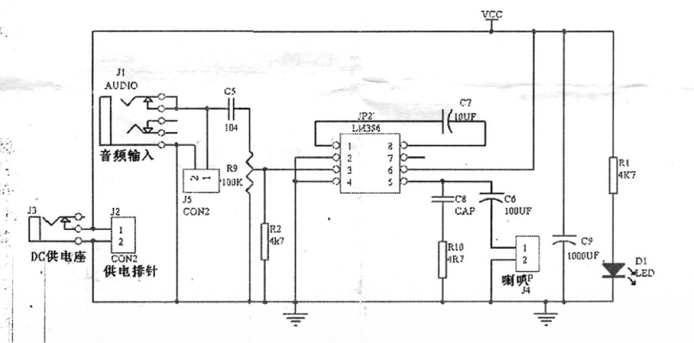
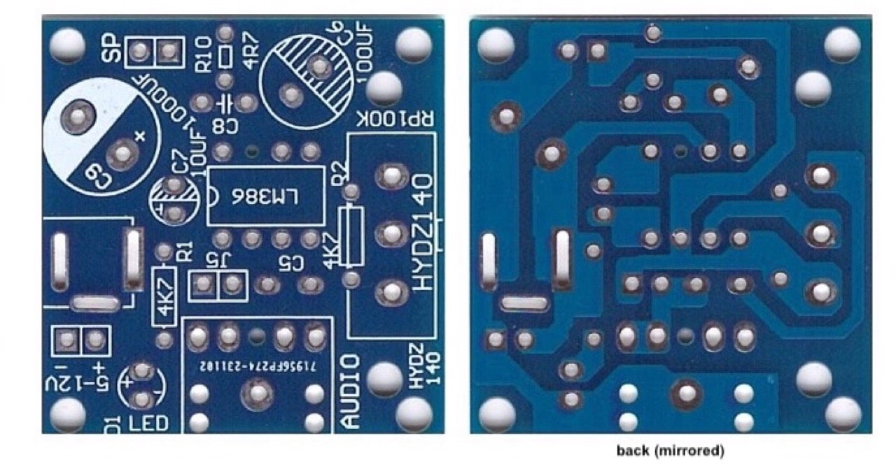

# #xxx LM386 Amplifier Module Kit

Building a common single-channel LM386 amplifier kit, with some modifications the the input wiring to support auxiliary bypass and mono inputs.

Here's a quick demo..

## Notes

LM386-based amplifiers are easy to build, but they are also readily available as kits or modules.
I've wanted to take a closer look at one of the kits to see if they yield any interesting secrets,
so I purchased an example from SZFYDOSH Technology Store for SG$1.14 (Nov-2026):
["LM386 Mini Audio Amplifier DIY Kit 3.5MM 3V-12V Power Amplifier Suite Amplificador Module Board Beyond TDA2030" (aliexpress seller listing)](https://www.aliexpress.com/item/1005005869400965.html)

The kit even comes in a little plastic storage box that will no doubt find a use in the workshop:

### The LM386

The LM386 is a low-voltage, low-power audio power amplifier integrated circuit, originally developed by National Semiconductor in the mid-1970s. It operates from a single power supply, typically between 4V and 12V, and requires very few external components to produce an audio amplifier with a typical output power of up to 0.5W. Its internally configured voltage gain is 20 (26dB). The chip incorporates internal biasing, thermal protection and a bypass pin for reducing power-supply and bias-related noise. With its low component count, small size and ease of use, the LM386 is widely used in battery-powered audio devices, small radios, intercoms, portable speakers and simple guitar practice amplifiers.

## Kit Parts

| Ref    | Qty | Part                            |
|--------|-----|---------------------------------|
| R1,2   |   2 | 4.7kΩ resistor                  |
| R9     |   1 | 100kΩ pot                       |
| R9     |   1 | knob for pot                    |
| R10    |   1 | 4.7Ω resistor                   |
| C5,8   |   2 | 100nF ceramic capacitor         |
| C6     |   1 | 100µF electrolytic capacitor    |
| C7     |   1 | 10µF electrolytic capacitor     |
| C9     |   1 | 1000µF electrolytic capacitor   |
| D1     |   1 | 3mm red LED                     |
| J1     |   1 | 3.5mm stereo socket             |
| J2,4,5 |   6 | 6 pin header (split to 3x2pins) |
| J3     |   1 | 5.5x2.1mm power socket          |
| U1     |   1 | LM386M-91                       |
| U1     |   1 | DIP8 socket                     |
| PCB    |   1 | board                           |

### Circuit Design

The circuit schematic is included in the kit instructions:

I redrew the circuit for clarity with Fritzing: see [LM386ModuleKit.fzz](./LM386ModuleKit.fzz).

### The PCB

Before assembly, I luckily had a closer look at the PCB and noticed that the audio input jack could be connected in a better way.

As designed, the J1 audio-in is tapped from the ring connector, and J5 is wired in parallel. While this will usually work, there are two issues:

* it won't work with mono plugs since the audio tapped from sleeve and ring connectors. Mono plugs feed from tip and sleeve, with ring shorted to sleeve.
* J5 doesn't work as an auxiliary input - both J5 and J1 remain connected to the audio chain, even if sources are connected to both inputs

Before proceeding with the build, I re-patched the J1 and J5 inputs so they are more functional:

* audio-in is now tapped from J1 tip. This means it will work with both mono and stereo plugs.
* J5 is re-routed via the J1 tip by-pass connection. This allows it to function and auxiliary input. With an audio source connected to J5:
    * it will drive the amplified while no plug is inserted into J1
    * But if a plug is inserted into J1, it will disconnect J5 and drive the amp from J1 instead.

### Construction

Construction complete:

Under test .. and it works pretty well!

## Credits and References

* ["LM386 Mini Audio Amplifier DIY Kit 3.5MM 3V-12V Power Amplifier Suite Amplificador Module Board Beyond TDA2030" (aliexpress seller listing)](https://www.aliexpress.com/item/1005005869400965.html)
    * Purchased from SZFYDOSH Technology Store for SG$1.14 (Nov-2026)
    * See [instructions](./assets/kit-instructions.pdf)
* [LM386 Product Info - TI](https://www.ti.com/product/LM386)
* [LM386 datasheet](https://www.futurlec.com/Linear/LM386N-3.shtml)
