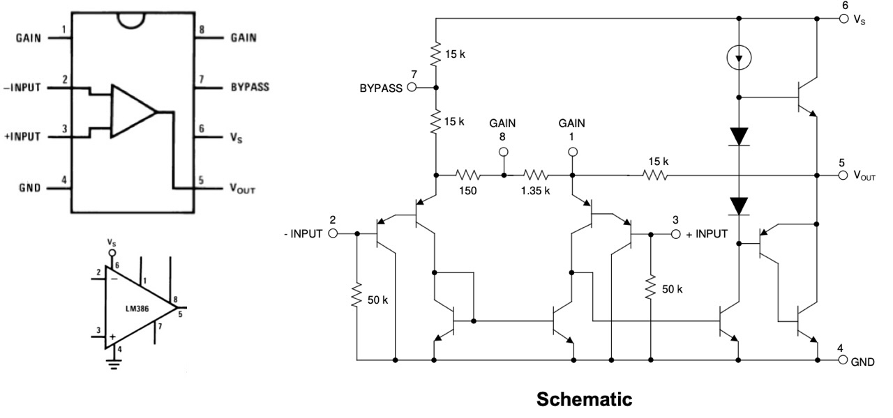
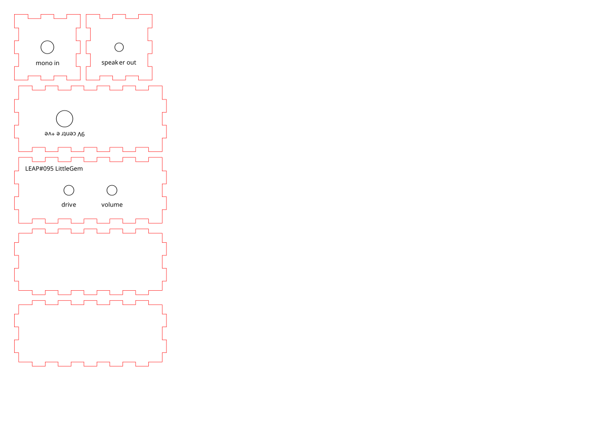

# #095 Little Gem

A basic Smokey-inspired LM386 guitar power amp.

## Notes

The "Little Gem" amplifier by [runoffgroove](https://www.runoffgroove.com/littlegem.html)
is one of numerous LM386-based amplifiers descending from the [original Smokey amp](https://www.smokeyamps.com/).
The "A386" is a "Little Gem" variant by [General Guitar Gadgets](https://generalguitargadgets.com/effects-projects/amps/a386-amp/)
that basically packages the circuit with a few more frills like a conventional pedal.

The Smokey is about as basic as you can get - [an LM386 and two caps](https://web.archive.org/web/20260518123756/https://electrosmash.com/smokey-amp-analysis),
see [LEAP#096 Smokey](../Smokey/).

Little Gem/A386 takes some of the [suggestions by Dave Stork](https://web.archive.org/web/20061014131022/http://www.blueguitar.org/new/schem/_ss/smokey.txt) and
enhances the circuit in a few ways:

* adds variable gain control ranging from about [25](https://www.wolframalpha.com/input/?i=2*15000%CE%A9%2F%28150+%2B+1%CE%A9%2F%281%2F1350+%2B+1%2F5000%29%29) to [200](https://www.wolframalpha.com/input/?i=2*15k%CE%A9%2F%28150+%2B+0%CE%A9%29) (the original Smokey was fixed at 200)
* adds input AC coupling with a 10nF capacitor and removes the 47μF bypass capacitor
* adds output-side master volume control
* adds an output-compensating [Zobel Network](https://en.wikipedia.org/wiki/Zobel_network)
* increases the output coupling capacitor from 47μF to 220μF to improve low-end performance
* A386 modifications add a power indicator, power-source selection and reverse-polarity protection

## Circuit Design

Designed with Fritzing: see [LittleGem.fzz](./LittleGem.fzz).

Some things to note for my build:

* I didn't have anything as small as a 25Ω rheostat for output volume control, but a 22Ω resistor across a 2kΩ trimpot provides decent control, from a
[range of about 0-22Ω](https://toolbox.tardate.com/?formula=22%7C2000#ResistorCalculator)
* the 1N4001 sacrifices quite a bit of headroom for some reverse-polarity protection

## Parts

| Ref | Qty | Part                         | Notes                                   |
|-----|-----|------------------------------|-----------------------------------------|
| U1  |   1 | LM386N-1                     |                                         |
| C1  |   1 | 100µF electrolytic capacitor |                                         |
| C2  |   1 | 200µF electrolytic capacitor |                                         |
| C3  |   1 | 47nF ceramic capacitor       | polyester (Mylar) used in protoboard v2 |
| C4  |   1 | 10nF ceramic capacitor       | polyester (Mylar) used in protoboard v2 |
| R1  |   1 | 5kΩ pot                      |                                         |
| R2  |   1 | 2kΩ pot                      |                                         |
| R3  |   1 | 470Ω resistor                |                                         |
| R4  |   1 | 10Ω resistor                 |                                         |
| D1  |   1 | 1N4001 rectifier diode       | unused in final build                   |
| LED1|   1 | 3mm green LED                | unused in final build                   |

## Performance

The circuit works surprisingly well on a breadboard.
Distorted tones work well. I was not able to get a very clean signal, except at a very low volume.

For a small build, the speaker itself is a major contributor to the performance of the system.
I am using a small 8Ω speaker that works adequately for testing.

## Protoboard Build v1

I've transferred the design to a piece of protoboard.
This worked OK, however it was still quite susceptible to interference and early clipping.

## Protoboard Build v2

I made another version on protoboard, with some modifications that greatly improve performance.
Essential changes:

* use polyester (mylar) capacitors for the main ones in the audio chain.
* use twisted wire connections
* star ground pattern
* removed the reverse-polarity protection diode
* removed the power indicator LED (for now)

In action..

## Case

I made a simple MDF case with [MakerCase](https://en.makercase.com/) - [box-template.svg](box/box-template.svg),
and refined the design in Affinity Designer, see [little-gem.afdesign](./box/little-gem.afdesign).

I prepared the parts in
[little-gem.xs](./box/little-gem.xs)
for cutting from 3mm MDF on my Library's [xTool S1 Laser Cutter](https://leap.tardate.com/equipment/nlb/xtools1/).

I'll update the notes once I've cut the box.

## Credits and References

* [LEAP#096 Smokey](../Smokey/)
* [Little Gem & Little Gem MkII](https://www.runoffgroove.com/littlegem.html)
* [General Guitar Gadgets A386 Amp](https://generalguitargadgets.com/effects-projects/amps/a386-amp/)
* [Smokey Amps](https://www.smokeyamps.com/) - official site
* [Smokey Amp Analysis](https://web.archive.org/web/20260518123756/https://electrosmash.com/smokey-amp-analysis) - excellent circuit analysis of the original Smokey amp.
* [Observations on the Smokey circuit by Dave Stork](https://web.archive.org/web/20061014131022/http://www.blueguitar.org/new/schem/_ss/smokey.txt)
* [LM386 Product Info - TI](https://www.ti.com/product/LM386)
* [LM386 datasheet](https://www.futurlec.com/Linear/LM386N-3.shtml)
