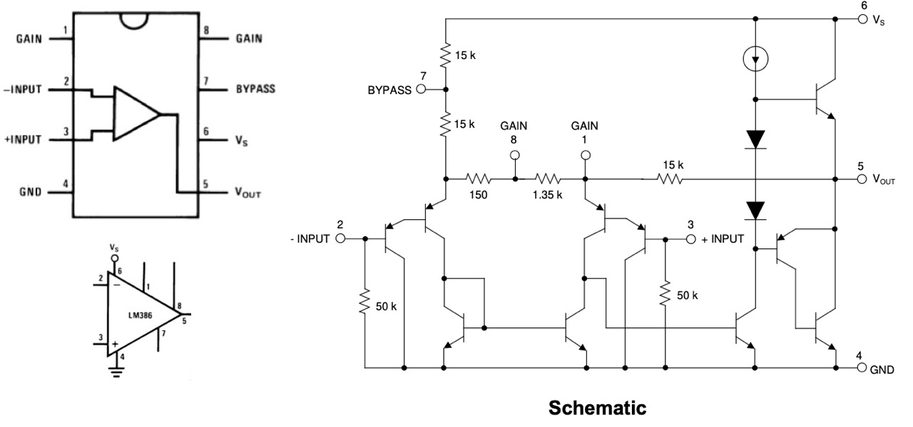
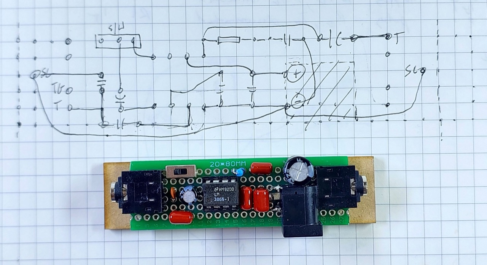
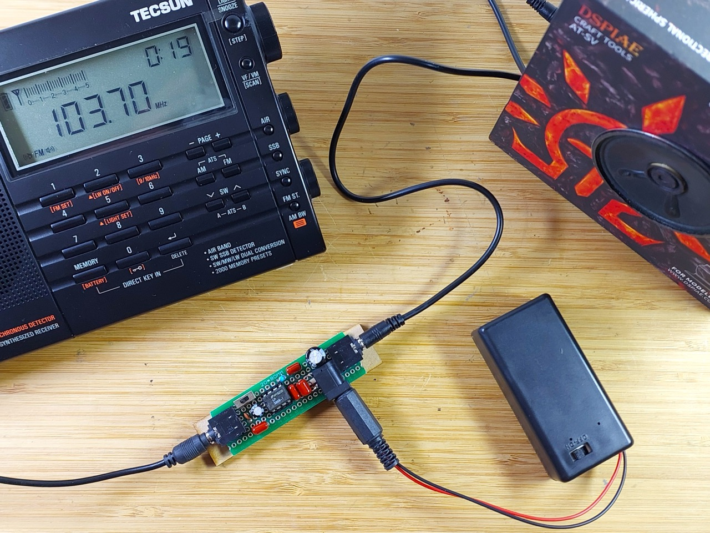

# #871 Perfect LM386 Amplifier Circuit?

Incorporating all of the best design advice to hopefully produce the best LM386 amplifier circuit possible. And it does in fact perform rather impressively.

Here's a quick demo..

## Notes

The LM386 is a low-voltage, low-power audio power amplifier integrated circuit, originally developed by National Semiconductor in the mid-1970s. It operates from a single power supply, typically between 4V and 12V, and requires very few external components to produce an audio amplifier with a typical output power of up to 0.5W. Its internally configured voltage gain is 20 (26dB). The chip incorporates internal biasing, thermal protection and a bypass pin for reducing power-supply and bias-related noise.

The **good news** about the LM386 is the component count, small size and ease of use means that the LM386 has shown up in many circuits and has been widely used in battery-powered audio devices, small radios, intercoms, portable speakers and simple guitar practice amplifiers.

The **bad news** is that many of those circuits are pants! Some don't even follow the most basic recommendations in the data sheet.

So what is a "good" or even "perfect" LM386 audio amplifier circuit? Perhaps I can find all the best practices and give them a go.

That's what this circuit is all about...

### The PERFECT LM386 audio amplifier?

Enter this very informative video by JohnAudioTech:
["Make the PERFECT LM386 audio amplifier?"](https://www.youtube.com/watch?v=P4GsoMTv-SY).
Some of the key takeaways..

Input stage:

* Input coupling and filter:
    * AC-couple the input (C1), to ensure any incoming DC offset won't cause clipping
    * Add a low-pass filter on the input (C2)
* Don't short the reference voltage bias resistor
    * Inverting input AC-coupled to ground (C3) to avoid bypassing the internal input bias resistor
* Input volume pot is optional:
    * 10kΩ audio/log for line level
    * 100kΩ linear for instruments (because of internal 50kΩ pulldown)
    * ground the pot case
    * if the source has volume control, then it is not really needed here
    * if not needed, better to leave out to avoid noise issues

Gain stage:

* Only add as much gain as required
    * Line level - no additional gain required (default 20x)
    * Instrument input - probably need more gain (max 200x with 10µF across pins 1-8)
* Add bypass cap on pin 7, especially with noisy power supplies
    * Connecting an optional 10µF capacitor between pin 7 (bypass) and ground filters out high-frequency power supply ripple and prevents noise from entering the high-gain internal stages.

Output stage:

* Use with a suitable speaker >= 8Ω
    * 4Ω load has a very poor current v voltage curve - doesn't deliver much power to speaker
* Output coupling capacitor (C6)
    * 470µF large enough, don't need high as not expecting so much bass from this amp
    * Could be lower like 200uF for guitar amp, as don't need the bass response

General Design Guidelines:

* Use Polyester/Mylar caps for main audio path. Compared with ceramic/MLCC caps:
    * extremely low audio signal distortion
    * very low microphonics/noise
    * high capacitance stability
* PCB layout:
    * Aim for star-ground layout to avoid power and other signals on audio traces
* Power supply smoothing (C4)
    * larger values don't make much difference
    * 270nF instead of 100nF per datasheet
    * with a battery, not so important
* Use 9V supply:
    * lower voltages such as 5V won't deliver max power output
    * unless using LM283M-3 1W (18V) variants
* Twist wires to avoid differential-mode noise
    * Signal and Return: Always twist a signal wire directly with its specific ground or return wire, rather than twisting multiple unrelated signals together.
    * Power and Ground: Twist positive and negative DC power lines together to contain the magnetic loop area and prevent them from radiating noise to nearby circuits.

### The "Perfect" Circuit Realised

Designed with Fritzing: see [Perfect386.fzz](./Perfect386.fzz).

So let's boil it down to an actual build.
Some specific decisions I've made:

* 220nF for C1,C3 since that is what I have on hand. I suspect not significantly different performance than the 270nF used by JohnAudioTech
* No bypass capacitor on pin 7 since I'm using a battery power supply
* Added S1 to select between 20x and 200x gain

Parts:

| Ref  | Qty | Item                                           |
|------|-----|------------------------------------------------|
| IC1  |   1 | LM386N-1 IC                                    |
| R1   |   1 | 10Ω 1/8W resistor                              |
| C1,3 |   2 | 220nF 100V Polyester (Mylar) film capacitor    |
| C2   |   1 | 47pF ceramic capacitor                         |
| C5   |   1 | 100nF 100V Polyester (Mylar) film capacitor    |
| C6   |   1 | 470µF 16V electrolytic capacitor               |
| C7   |   1 | 10µF 16V electrolytic capacitor                |
| J1   |   1 | 5.5x2.1mm barrel jack                          |
| J2,3 |   2 | 3.5mm stereo TRS jack                          |
| S1   |   1 | SPDT switch                                    |

### Breadboard Build

The circuit works surprisingly well even on a breadboard.
For testing, I manually added or removed the 10µF gain capacitor as required.

### Protoboard Build

I finally transferred the circuit to a 2x8cm protoboard. This is the layout I used:

Tested with FM radio input. Works beautifully!
I haven't made any measurements of gain or harmonic distortion (yet).
See [JohnAudioTech's video](https://www.youtube.com/watch?v=P4GsoMTv-SY) for the measurements he made.

## Credits and References

* [LM386 Product Info - TI](https://www.ti.com/product/LM386)
* [LM386 datasheet](https://www.futurlec.com/Linear/LM386N-3.shtml)
* <https://hackaweek.com/hacks/the-12-watt-lm386-audio-amplifier/>
* ["5PCS/LOT LM386N-1 LM386N LM386 DIP-8 LM386N-3 LM386N-4" (aliexpress seller listing)](https://www.aliexpress.com/item/1005007961174796.html)
    * Purchased 5x LM386N-1 from QIAOMAER electronicchip Store for S$1.70 after discounts (Nov-2026)
* ["CBB Capacitor Assortment Kit 100V 10nF - 470nF 100PCS=10values*10pcs Metallized Polyester Film Capacitors KIT DIY" (aliexpress seller listing)](https://www.aliexpress.com/item/1005004708203976.html)
    * Purchased 1 pack from DSSRQI Official Store for S$2.56 after discounts (Nov-2026)

### Make the PERFECT LM386 audio amplifier?

YouTube by JohnAudioTech

