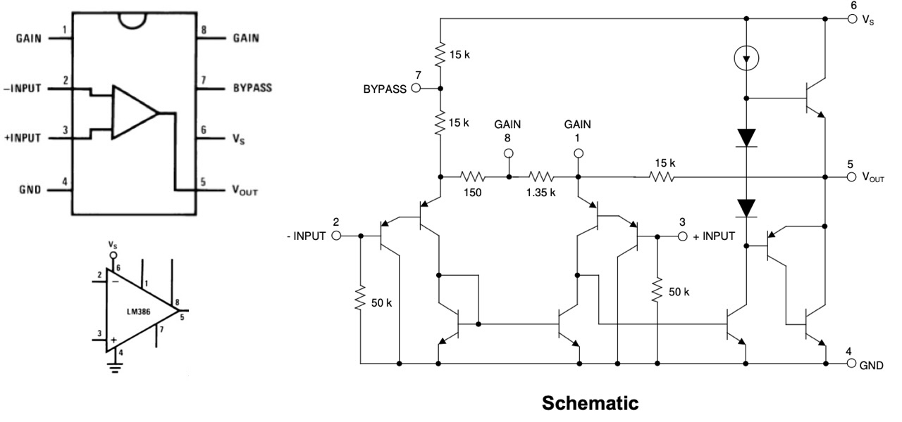
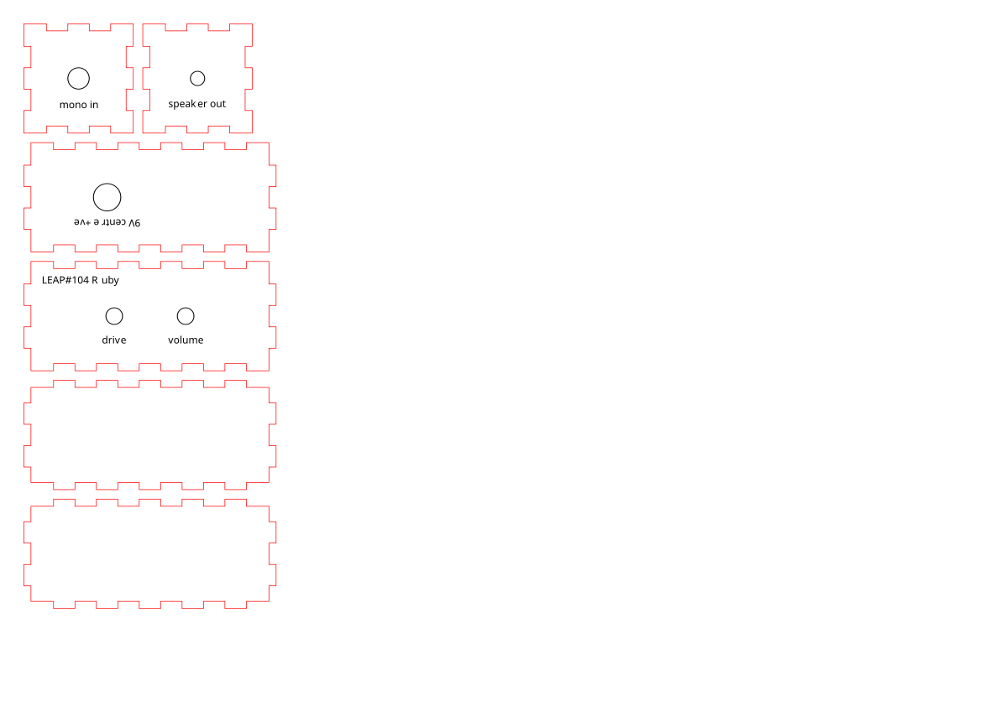

# #104 Ruby Guitar Amp

A version of the runoffgroove Ruby LM386 guitar amp.

## Notes

The Ruby amp is similar to the [LittleGem](./LittleGem), however it introduces a JFET buffer on the input and discrete volume and gain controls for the LM386.

The build here is based on the [runoffgroove schematic](http://www.runoffgroove.com/ruby.html), but with a few variations:

* adds a coupling capacitor on the input
* J201 n-channel JFET instead of the original MPF102

## Circuit Design

Designed with Fritzing: see [Ruby.fzz](./Ruby.fzz).

NB: in the schematic below, the FET symbol is not quite correct (shows n-channel MOSFET instead of JFET)

## Breadboard Build

Running the amp on a breadboard is possible, but noise and interference can be a real problem.
So performance on a breadboard is not a very good indicator of actual performance if you build the circuit on a PCB.

## Protoboard Build

Running on a protoboard. Works really well! I need to find some pots to replace the trimmers then I can mount it properly.

Here's the layout I used:

## Case

I made a simple MDF case with [MakerCase](https://en.makercase.com/) - [box-template.svg](box/box-template.svg),
and refined the design in Affinity Designer, see [ruby.afdesign](./box/ruby.afdesign).

I prepared the parts in
[buildings.xs](./box/ruby.xs)
for cutting from 3mm MDF on my Library's [xTool S1 Laser Cutter](https://leap.tardate.com/equipment/nlb/xtools1/).

I'll update the notes once I've cut the box.

## Credits and References

* [Ruby](http://www.runoffgroove.com/ruby.html) 386-based 9v battery amp
* [LM386 Product Info - TI](https://www.ti.com/product/LM386)
* [LM386 datasheet](https://www.futurlec.com/Linear/LM386N-3.shtml)
* [J201 datasheet](https://www.futurlec.com/Transistors/J201.shtml)
