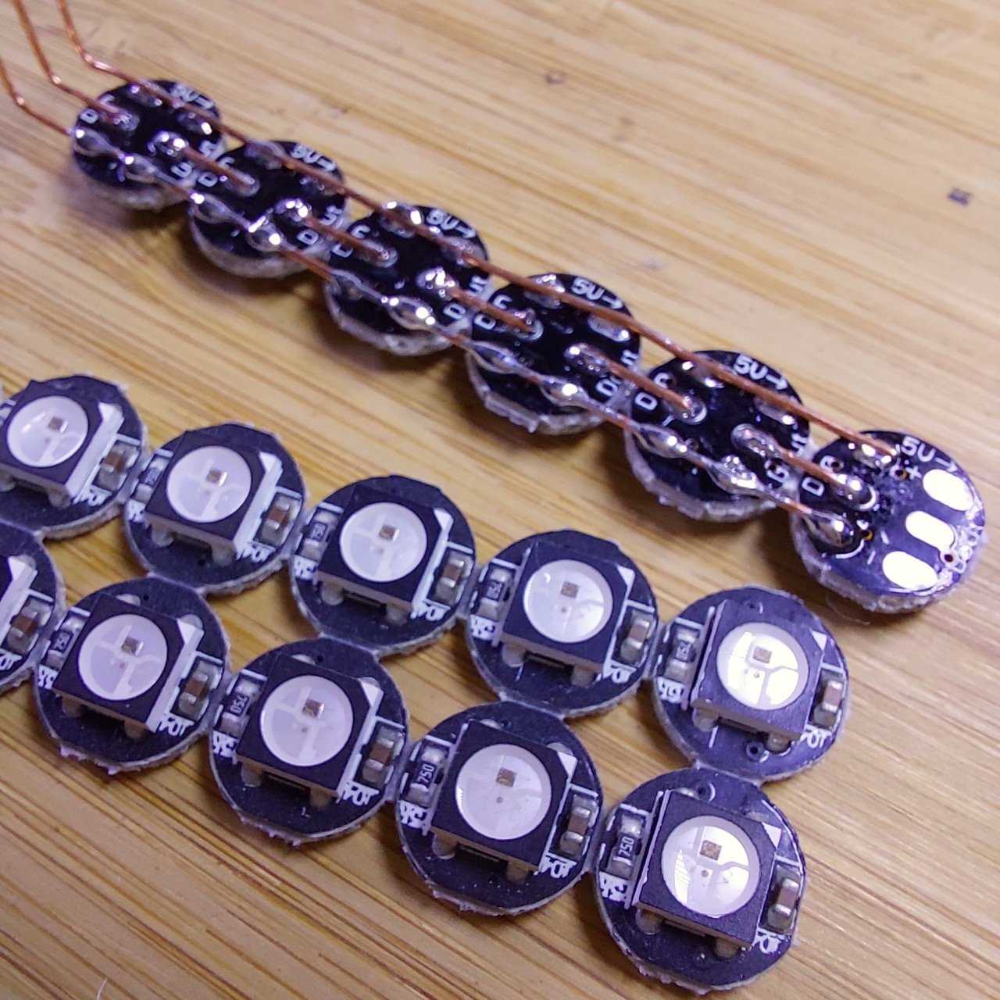
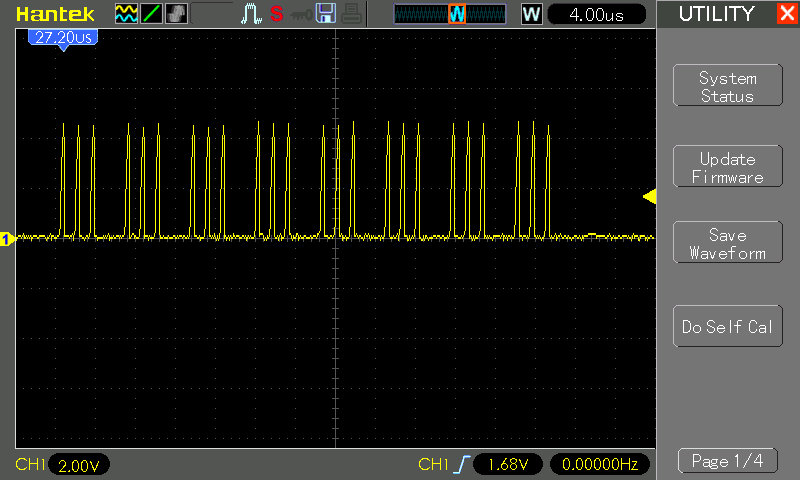
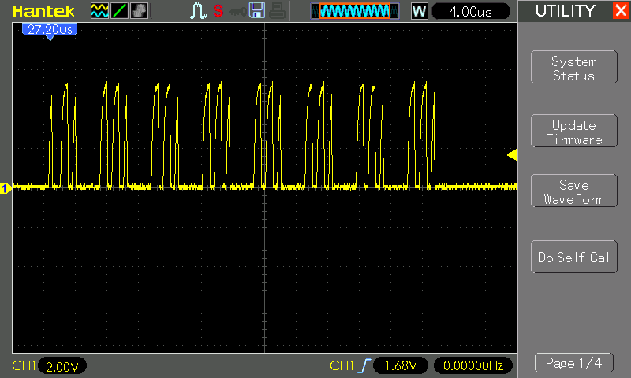
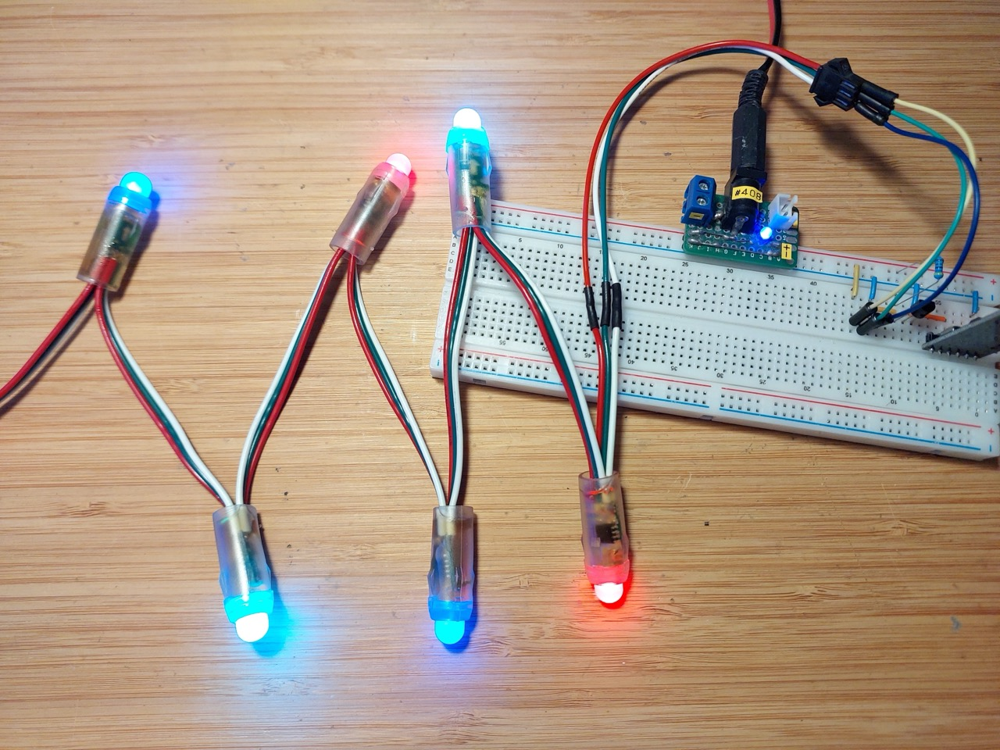

# #868 LED Array Control from macOS

Controlling a string of WS2811 or WS2812B LEDs from macOS through a CH340-based UART-TTL adapter.


Here's a quick demo..

[](https://www.youtube.com/watch?v=Kj2igdYWEjA&list=PLjnHiRINFqis5VhLbJE87ZiEhpWMnrP2X)

## Notes

Steve Schnepp posted how to
["Drive a WS2812B strip with an UART"](https://blog.pwkf.org/2024/03/20/drive-ws2812-uart.html),
building on earlier work by Josh Levine:
["Give Your Raspberry Pi a NeoPixel"](https://wp.josh.com/2014/09/02/give-your-raspberrypi-a-neopixel/).

It has long been on my todo list to try this out from macOS,
and after a bit of fiddling I have some success driving both
modern WS2812B COB units and older WS2811 strips from macOS over a CH340 UART-TTL interface.

Conclusions:

* On macOS, need to stream data with a program or script that can set the correct baud rate, rather than rely on `stty`
* Although strictly over-clicking the CH340, use 2500000 baud for WS2812B
* Older WS2811 may require reduction to 1250000 baud
* A 2N7000 MOSFET works nicely to to invert the active-low TTL to active-high WS28xx logic.
* Data transfer timing is generally reliable, though not 100%.

### About ws2812bify

Steve's [ws2812bify](https://github.com/steveschnepp/ws2812bify) tools
for controlling a WS2812B strip with an UART were I think developed for Linux or Raspberry Pi.
Although I can compile them on macOS, they can't be used because they rely on separately setting the
the UART baud rate with `stty`, but on macOS this can only be used on an open port, and resets to default when closed.

### Python Port for macOS

So, for macOS, I ported the main script to python - see [ws2812bify.py](./ws2812bify.py).
This takes care of opening the serial port with the required baud rate.
Usage:

```sh
$ ./ws2812bify.py -h
usage: ws2812bify.py [-h] -p PORT [-b BAUDRATE] [-s] [-v]

WS2812B Control. Reads NUA-format color data from stdin and sends it to a serial device. NUA hex format: [DD]RRGGBB[ RRGGBB[ RRGGBB] ... ] where DD is the duration in 10ms units, and RRGGBB is the color, though some
devices read the color as GGRRBB.

options:
  -h, --help            show this help message and exit
  -p PORT, --port PORT  Serial device name
  -b BAUDRATE, --baudrate BAUDRATE
                        Baud rate for serial communication
  -s, --stream          Stream each line as received, default is to read all lines before sending
  -v, --verbose         Enable verbose output
```

### Circuit Design

The UART transmit line is active-low, so we need an inverter to make the data stream compatible with the active-high WS2812B protocol.

Steve Schnepp experimented with various RTL/DTL schemes to get sufficiently fast switching transients,
but I've gone with a simple MOSFET switch.

A 4.7kΩ pull-up on the data line seems to provide a sufficiently hard drive. Any higher and it can mess with the timing.

Importantly, I use a dedicated power supply for the LED strip instead of trying to draw the power through the UART.
NB: if only trying to drive 1 or 2 LEDs, powering via the UART is feasible.

Designed with Fritzing: see [WS2812BControl.fzz](./WS2812BControl.fzz).


I made up a strip of 6x WS2812B COB LEDs for the demo.
These are individual LED units like the Adafruit NeoPixel.
I purchased a set of 20 for US$3.12 (Nov-2017): ["WS2812B Matrix 4-Pin WS2812 LED Chip & Heatsink 5V 5050 RGB WS2811 IC Built-in 10~1000pcs(100pcs/board)" (aliexpress seller listing)](https://www.aliexpress.com/item/32463004816.html).



WS2812B strips typically expect Green-Red-Blue order, and that is in fact how these LEDs decode the data stream.

Testing on a breadboard:


### CH340 Interface

For these tests, I'm using a CH340-based UART-TTL adapter plugged into my iMac.
See [LEAP#736 CH340 on Apple Silicon](../) for more info on the interface and drivers.

It's showing up on the following device handles:

```sh
$ ls -1 /dev/*usb*
/dev/cu.usbserial-2420
/dev/cu.wchusbserial2420
/dev/tty.usbserial-2420
/dev/tty.wchusbserial2420
```

### Full Demo Cycle

The [demo.nua](demos/demo.nua) file describes a sequence that sends Green-Red-Blue-White pulses up and back down the strip:

```sh
$ ./ws2812bify.py -p /dev/cu.usbserial-2420 < demos/demo.nua
Sending buffered data to /dev/cu.usbserial-2420 at 2500000 baud...
$ ./ws2812bify.py -p /dev/cu.usbserial-2420 -s < demos/demo.nua
Streaming data to /dev/cu.usbserial-2420 at 2500000 baud...
```

Or to run continuously:

```sh
for (( ; ; )) ; do ./ws2812bify.py -p /dev/cu.usbserial-2420 < demos/demo.nua ; done
```

### Waveforms

The baud rate is a bit too fast for my oscilloscope to capture accurate waveforms, but I can at least get the gist of what is going on.

Sending 1 pixel set to white:

```sh
$ echo -e "00FFFFFF" | ./ws2812bify.py -p /dev/cu.usbserial-2420
Sending data to /dev/cu.usbserial-2420 at 2500000 baud...
```



Sending 1 pixel set to black (off):

```sh
$ echo -e "00000000" | ./ws2812bify.py -p /dev/cu.usbserial-2420
Sending data to /dev/cu.usbserial-2420 at 2500000 baud...
```



### Using a WS2811 Strip

Both the WS2811 and WS2812B operate at a standard data rate of 800 kbps (800 kHz), though older WS2811 chips also support a slower 400 kbps (400 kHz) mode.

I have an old string WS2811 LEDs. They only seem to work at the slower data rate.

The demo sequence runs nicely if we cut the baud rate in half:

```sh
$ for (( ; ; )) ; do ./ws2812bify.py -p /dev/cu.usbserial-2420 -b 1250000 < demos/demo.nua ; done
$ ./ws2812bify.py -p /dev/cu.usbserial-2420 -b 1250000 < demos/demo.nua
Sending data to /dev/cu.usbserial-2420 at 1250000 baud...
```

They also interpret the data stream as Red-Green-Blue.
Sending R-G-B-R-G-B to the first 6 LEDs:

```sh
$ echo "00FF0000 00FF00 0000FF FF0000 00FF00 0000FF" | ./ws2812bify.py -p /dev/cu.usbserial-2420 -b 1250000
Sending data to /dev/cu.usbserial-2420 at 1250000 baud...
```



## Credits and References

* ["Drive a WS2812B strip with an UART"](https://blog.pwkf.org/2024/03/20/drive-ws2812-uart.html).
    * <https://github.com/steveschnepp/ws2812bify>
* ["Give Your Raspberry Pi a NeoPixel"](https://wp.josh.com/2014/09/02/give-your-raspberrypi-a-neopixel/)
* ["WS2812B Matrix 4-Pin WS2812 LED Chip & Heatsink 5V 5050 RGB WS2811 IC Built-in 10~1000pcs(100pcs/board)" (aliexpress seller listing)](https://www.aliexpress.com/item/32463004816.html)
    * Purchased strip of 20 for US$3.12 (Nov-2017)
    * No longer available from this seller as of Nov-2026. Same/similar product currently available: ["10-1000PCS WS2812B WS2812 4Pin RGB Led Chip 5050SMD WS2811 IC Black/White PCB With Heatsink DC5V"](https://www.aliexpress.com/item/32560280169.html)
