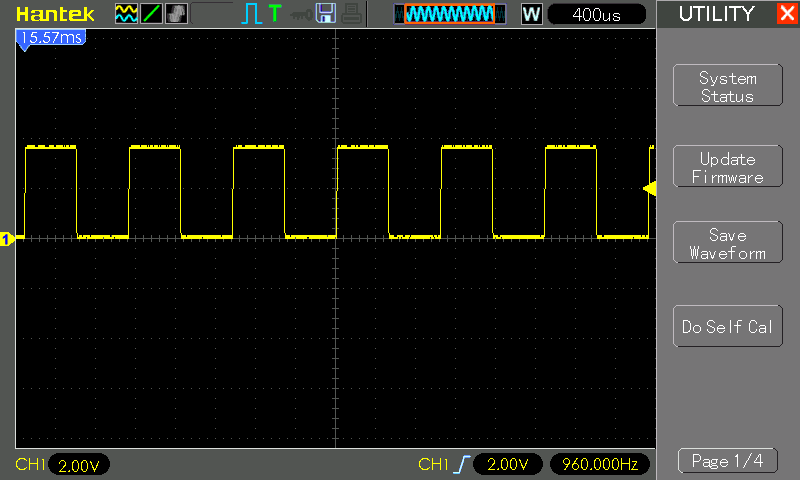

# #873 LM386 Oscillator

Letting the LM386 amplifier break free as the oscillator it always wanted to be.

## Notes

There's a saying that amplifiers are oscillators that don't, and oscillators are amplifiers that do.
Controlling oscillation can be a major challenge especially in high gain LM386 circuits.
So let's embrace the fact and actually make an oscillator.

The [LM386 TI Datasheet](https://www.ti.com/product/LM386).
actually has an example of this - see 9.2.6 Square Wave Oscillator.

### The LM386

The LM386 is a low-voltage, low-power audio power amplifier integrated circuit, originally developed by National Semiconductor in the mid-1970s. It operates from a single power supply, typically between 4V and 12V, and requires very few external components to produce an audio amplifier with a typical output power of up to 0.5W. Its internally configured voltage gain is 20 (26dB). The chip incorporates internal biasing, thermal protection and a bypass pin for reducing power-supply and bias-related noise. With its low component count, small size and ease of use, the LM386 is widely used in battery-powered audio devices, small radios, intercoms, portable speakers and simple guitar practice amplifiers.

### Circuit Design

This is based on the circuit in the datasheet, but with some component variations
to match common values.
The output is buffered by a MOSFET and just drives an LED for demonstration purposes.

Designed with Fritzing: see [Oscillator.fzz](./Oscillator.fzz).

Tested on a breadboard:

The resulting output, a 960Hz square wave:

## Credits and References

* [LM386 Product Info - TI](https://www.ti.com/product/LM386)
* [LM386 datasheet](https://www.futurlec.com/Linear/LM386N-3.shtml)
