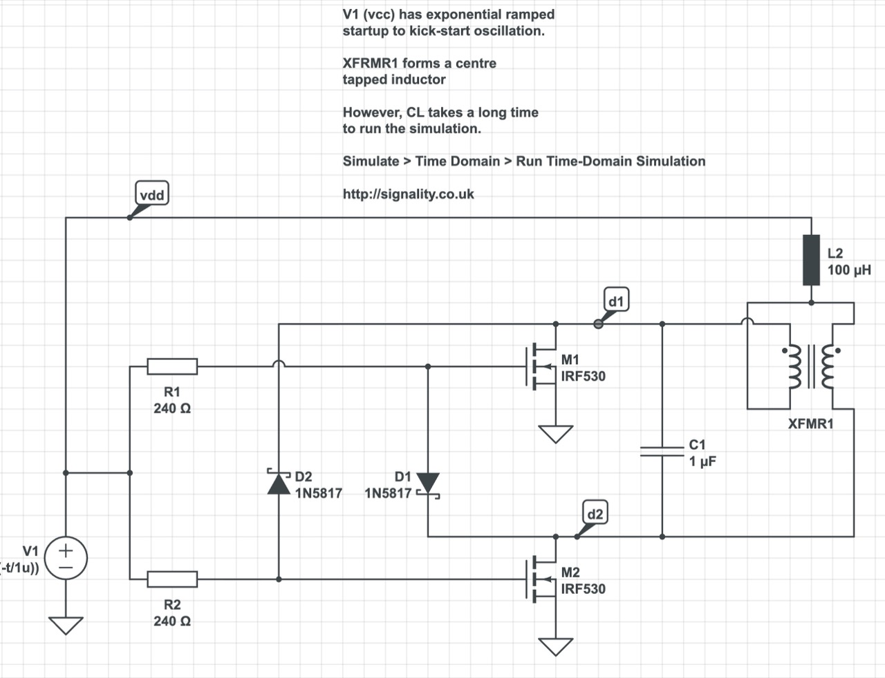
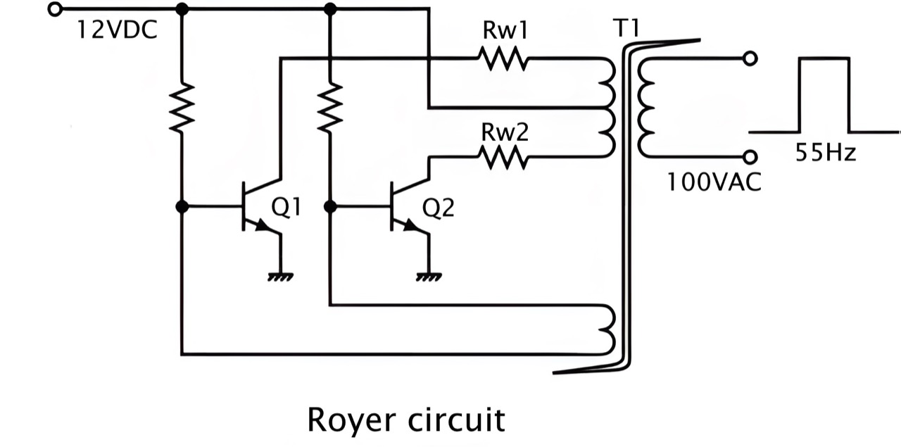
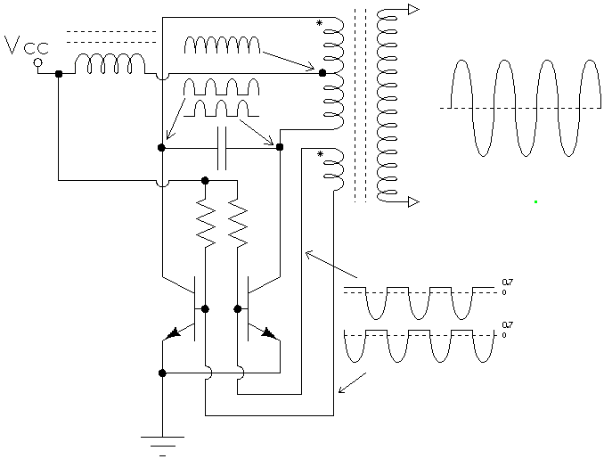
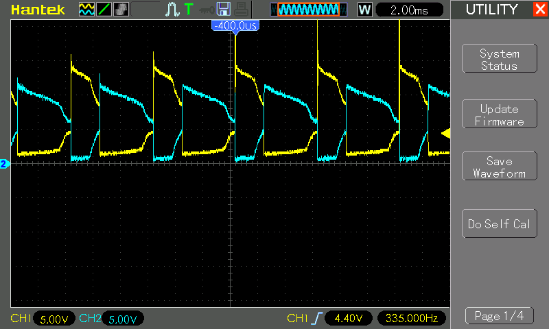

# #866 Baxandall Oscillator

Testing a simplified realisation of a Baxandall oscillator for driving AC loads (like a neon bulb) from low-voltage DC sources, with some investigation of the history of Royer, Baxandall, and derivative oscillators.

## Notes

The Baxandall Oscillator is a variant of the classic
[Royer oscillator](https://en.wikipedia.org/wiki/Royer_oscillator).
The Royer self-oscillates due to the saturation of a magnetic component, whereas the Baxandall self-oscillates due to L-C resonance.

Although these circuits originate from 1954 an later, variants are commonly used in DC-AC step-up converters for CCFL drivers and LED screen drivers, such as the module covered in
[LEAP#828 220V DC Boost Converter Module](../../Power/220vBoostConverterModule/)

I found a [simplified circuit](https://www.circuitlab.com/circuit/6f656p/mosfet-royer-like-oscillator-01/), described as a "Royer-like oscillator", and have used that as the basis for the tests below. The main advantage of the circuit concept is that it does not require a feedback winding on the transformer, so most AC step-down transformers can be used for experimentation.

### About the Royer Oscillator

A [Royer oscillator](https://en.wikipedia.org/wiki/Royer_oscillator) is an electronic relaxation oscillator that employs a saturable-core transformer in the main power path. It was invented and patented in April 1954 by Richard L. Bright & George H. Royer, who are listed as co-inventors on the patent.

It has the advantages of simplicity, low component count, rectangle waveforms, and transformer isolation.

As well as being an inverter, it can be used as a galvanically-isolated DC-DC converter when the transformer output winding is connected to a suitable rectifying stage, in which case the resulting apparatus is usually called a "Royer Converter".

The Royer oscillator circuit consists of a saturable-core transformer with a center-tapped primary winding, a feedback winding and (optionally) a secondary winding. The two halves of the primary are driven by two transistors in push-pull configuration. The feedback winding couples a small amount of the transformer power back to the transistor bases to provide positive feedback, thereby generating oscillation. The oscillation frequency is determined by the maximum magnetic flux density, the power supply voltage, and the inductance of the primary winding.

.png)

Later variants and improvements included:

* [Jensen Oscillator/Converter](https://en.wikipedia.org/wiki/Royer_oscillator#Jensen_Oscillator/Converter)
* [Current-Fed Royer/Jensen Converter](https://en.wikipedia.org/wiki/Royer_oscillator#Current-Fed_Royer/Jensen_Converter)
* [Regulated Current-Fed Royer/Jensen Converter](https://en.wikipedia.org/wiki/Royer_oscillator#Regulated_Current-Fed_Royer/Jensen_Converter)
* Sine wave Oscillator (Baxandall, aka "Resonant Royer")

### About the Baxandall Oscillator

[Peter Baxandall](https://en.wikipedia.org/wiki/Peter_Baxandall) described his parallel- and series-resonant class-D oscillators in  1959 in a paper in the Proceedings of the (British) Institute of Electrical Engineers (Baxandall, P.J, Proc I.E.E 106, B,  748 (1959)). See [The Baxandall parallel-resonant Class-D oscillator](http://www.sophia-electronica.com/Baxandall_parallel-resonant_Class-D_oscillator1.htm).

The circuit is useful for driving high turns-ratio step-up transformers – which have low self-resonant frequencies – used to generate high output voltages from battery-level inputs.

### Experimental Circuit Design

The design is based on the [simplified circuit found here](https://www.circuitlab.com/circuit/6f656p/mosfet-royer-like-oscillator-01/). Key components:

* a 240VAC to 12-0-12 step-down transformer (driven in reverse)
* IRF610 n-channel MOSFETs are used as the switching component, but I test alternatives
* 100µH toroid is used as L1. The value didn't seem significant for these tests.
* I test various diode, resistor and capacitor values

As a basic resistive load for the output, I have two white LEDs back-to-back with a 100kΩ resistor. I've also added a neon bulb just for fun, but not when measuring Vout as it caps the output voltage.

Designed with Fritzing: see [BaxandallOscillator.fzz](./BaxandallOscillator.fzz).

### Test Results

First, I am surprised this works as well as it does without too much futzing around!

I've tabulated the results below for some specific measurements as I vary components. The final component values I settled upon are those documented in the schematic above.

Some key points that I learned:

* varying the value of inductor L1 doesn't have a material impact on the oscillation frequency
* the ability to self-oscillate is highly sensitive to the input voltage for specific component selections

| Q      | D      | R     | C    | f     | Vin | Iin  | Vout(RMS) |
|--------|--------|-------|------|-------|-----|------|-----------|
| 2N7000 | 1N5819 |  220Ω |  1µF |  40Hz | 2V  | 13mA | 24V       |
| 2N7000 | 1N5819 |  10kΩ |  1µF |  70Hz | 2V  | 10mA | 27V       |
| 2N7000 | 1N5819 |  10kΩ |  1µF |  10Hz | 3V  | 70mA | 34V       |
| 2N7000 | 1N5819 |  10kΩ |100nF |  21Hz | 3V  | 72mA | 36V       |
| 2N7000 | 1N5819 |  10kΩ | 10nF |  23Hz | 3V  | 70mA | 40V       |
| 2N7000 | 1N5819 |  10kΩ |  1nF | 34kHz | 2V  |  1mA | 35V       |
| 2N7000 | 1N5819 |  10kΩ |  1nF |  28Hz | 3V  | 50mA | 45V       |
| 2N7000 | BAT85  |  10kΩ |  1nF | 310Hz | 2V  |  8mA | 32V       |
| IRF610 | 1N5819 |  220Ω |  1µF |  24Hz | 5V  | 75mA | 68V       |
| IRF610 | 1N5819 |  10kΩ | 10nF |  46Hz | 5V  | 60mA | 76V       |
| IRF610 | 1N5819 | 4.7kΩ | 10nF |  48Hz | 5V  | 48mA | 73V       |
| IRF610 | 1N5819 | 4.7kΩ |  1nF | 340Hz | 5V  | 60mA | 64V       |
| IRF610 | 1N5819 |  10kΩ |  1nF | 495Hz | 5V  | 50mA | 68V       |
| IRF610 | BAT85  |  10kΩ |  1nF | 356Hz | 5V  | 53mA | 71V       |
| IRF610 | BAT85  | 4.7kΩ |  1nF | 335Hz | 5V  | 60mA | 82V       |

Below is a trace of the voltages captured in the final configuration. I assume the asymmetry is purely down to component variations (and also why it is able to self-oscillate).

| Channel | Colour | Connection |
|---------|--------|------------|
| CH1     | Yellow | Q1 drain   |
| CH2     | Blue   | Q2 drain   |

## Credits and References

* [IRF610 Datasheet](https://www.futurlec.com/Transistors/IRF610.shtml)
* [BAT85 Datasheet](https://www.futurlec.com/Diodes/BAT85.shtml)
* [The Baxandall parallel-resonant Class-D oscillator](http://www.sophia-electronica.com/Baxandall_parallel-resonant_Class-D_oscillator1.htm)
* <https://en.wikipedia.org/wiki/Royer_oscillator>
* <https://electronics.stackexchange.com/questions/281262/royer-oscillator-circuit>
* <https://www.smps.us/inverters.html>
* <https://www.circuitlab.com/circuit/6f656p/mosfet-royer-like-oscillator-01/>
* <https://electronics.stackexchange.com/questions/175170/understanding-royer-oscillator-for-wireless-power-transfer-specially-mosfet>
* <http://blog.livedoor.jp/neotesla/archives/51423061.html>
* <https://www.scribd.com/doc/282678864/Royer-Oscillator-Baxandal>
* <https://www.analog.com/en/resources/app-notes/an-118fb.html>
