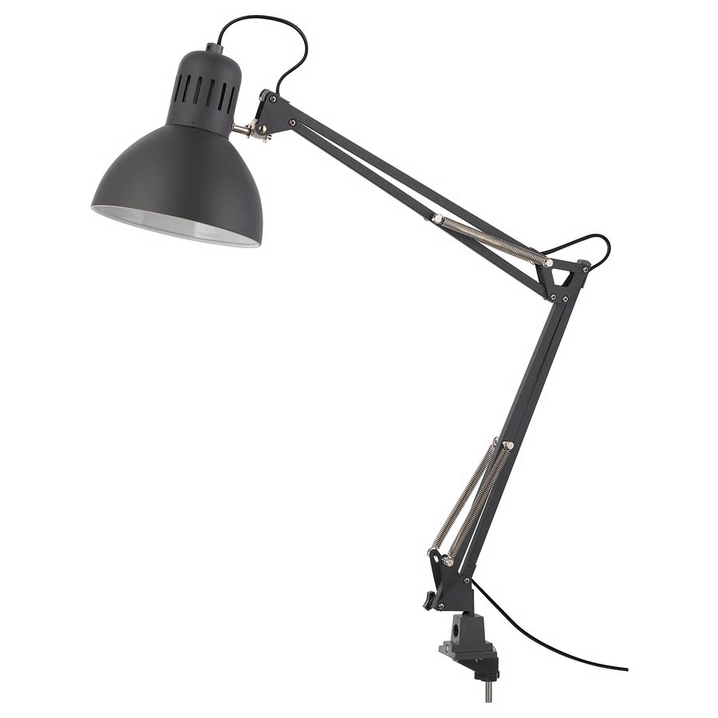
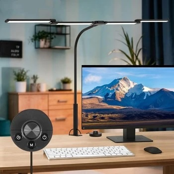
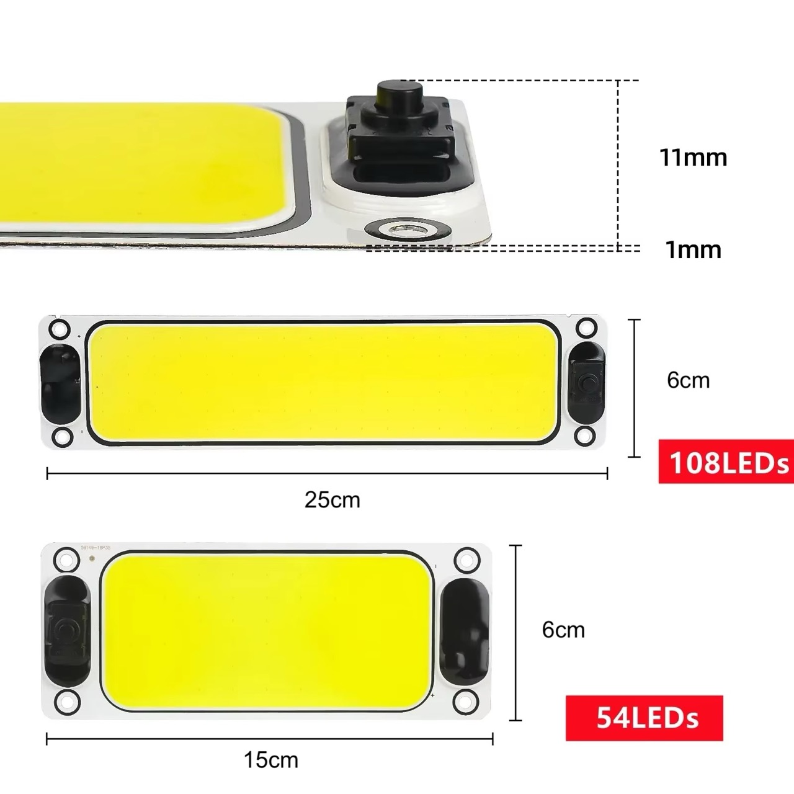
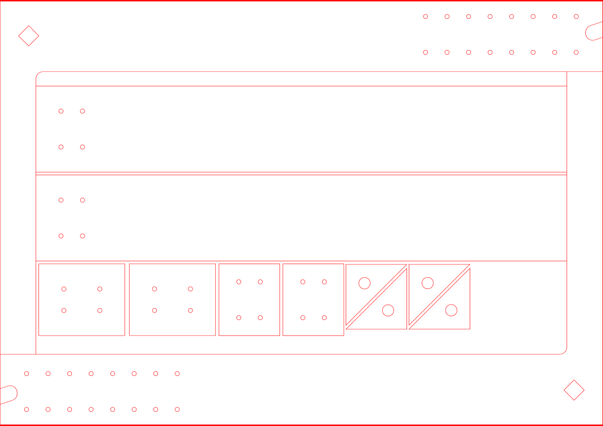

# #xxx Workbench Lighting II

Revamping the lighting for my standing workbench, with some COB LED lights, custom frame abd backdrop.

## Notes

I have been struggling with lighting on my workbench for a while.

I use a standing desk converter placed on my main workbench.
This is ideal for getting the work at an appropriate eye-level, and also let's me work standing. The "keyboard" tray is an ideal place for keeping my most used tools at hand.

Here's an old shot. Ignore the microphone stand, I no longer have it placed there, and the LED strip lights were a failed experiment to bring more light to the bench.

A single goose-neck lamp from Ikea ([TERTIAL](https://www.ikea.com/sg/en/p/tertial-work-lamp-dark-grey-50355395/)) has been my main focus lighting, but it has issues:

* The springs are sprung! No longer holds any given position without drooping.
* The light is uni-directional. Always needs re-positioning for working, and not good for photography.
* it is clamped to the main desk, so does not reposition  as I raise or lower the standing desk
* It's too dim for both my eyes (blame aging), but also photography.

I have procrastinated over improving the situation for ages. I keep looking for replacement lighting options but haven't found anything ideal. Most don't provide enough lumens, or are too flimsy/inflexible.

The closest I found  - and **almost** pulled the trigger on - was this 4 head LED with remote unit:
["80CM LED Desk Lamp 24W Study Lamp Dimmable Double Head Desk Light Table Light For Study Gaming Work" (shopee seller listing)](https://shopee.sg/80CM-LED-Desk-Lamp-24W-Study-Lamp-Dimmable-Double-Head-Desk-Light-Table-Light-For-Study-Gaming-Work-i.1497840575.56053821144).

I may still give this a go at some point, but the points that held me back

* SG$65.90 is a good price, but not exactly cheap for something that may not pan out
* Although not clearly stated, appears to provide up to 2000LM at max brightness, which I think is probably on the low end of what I require

### DIY Concept Sketch

So I decided to first experiment with a DIY solution.

My main requirements:

* Lighting
    * very bright LED, at least 2000 lumens
    * 5000K-6000K. ideally switchable color temperature but in this range if fixed
    * diffused/omni-directional
* Power
    * AC powered (direct or via adapter)
* Backdrop
    * built-in roller for backdrop that can be pulled down for photography
* Adapted to the standing bench
    * tabletop: 66cm x 40cm (36cm at narrowest point)

### LED Units

I have two COB LED panels (each with 108 LEDs) in my parts bin that I think could fit the bill.

I actually got them from different sellers as the listing appeared similar, but I was curious enough to buy both so I could compare. Turns out they are basically identical in design, with very slight manufacturing differences.

* ["12-24V Car LED Light Reading Night Strip Light Neon Lights Automotive Ceiling Lamp with On Off Switch Led lights for Vehicles" (aliexpress seller listing)](https://www.aliexpress.com/item/1005005806759882.html)
    * Purchased for SG$2.98 Oct-2024, but no longer available from this seller
* ["LED 12-24V Car Reading LED Night Strip Light Interior Light Ceiling Lamp with On Off Switch for Van Lorry Truck Camper Boat" (aliexpress seller listing)](https://www.aliexpress.com/item/1005005511135545.html)
    * Purchased for SG$2.24 Oct-2024, but no longer available from this seller

Although these are already pretty cheap, it seems prices have since dropped further and I can currently find them on special at [SGS$2.59 for 2x 108 LED units](https://www.aliexpress.com/item/1005009861784681.html).

From the seller's product listing:

> * LED technology : Energy-efficient LED lights provide bright and long-lasting illumination for your vehicle's interior.
> * Versatile voltage compatibility : Compatible with both 12V - 90V systems, making it suitable for use in a wide range of vehicles.
> * Easy installation : The strip light can be easily installed on your vehicle's ceiling or reading light without the need for any special tools or expertise.
> * On/off switch : The built-in on/off switch allows you to easily turn the light on and off, making it convenient to use while driving.
>
> Feature:
>
> * Brand new and high quality
> * Installation method: adhesive paste or screw
> * Function: with switch to control the lighting
> * Emitting Colors: Cold white
> * Waterproof: Yes
> * Applicable: Truck indoor lights, reading lamps, internal lighting
> * Lighting mode: Always bright
>
> Package List:
>
> * COB CHIP Light ;
> * Adhesive backing ;
> * Screw ;

#### LED Power

When wired up to my bench power supply, they each consume about 700mA @ 12V, around 8.4W.

Although rated for over 12V, increasing the voltage further does not significantly change the brightness, but it does increase the power consumption (and heat loss).

So for two units, I'll use a power supply rated for 12V and at least 2A.

#### LED Switching

Each unit has an integrated switch, which will allow selective control of the level of lighting.

#### Color Temperature

The units only have a single color temperature.
They specify "cool white", and this seems to be a case of the term being (mis-)used to represent something in the 5000-6000K range.

Although it would be ideal, I have not found any units that support adjustable color temperature.

Most COB units like this appears to be made on the high end (6000K),
although I have found some suppliers offering multiple color temperature options, for example:

* ["COOLEEON 120x36mm COB LED Bulb DC 12V 10W Light Emitting Diode Red Blue Warm Natural Cool White LED Lamp for DIY Lighting" (aliexpress seller listing)](https://www.aliexpress.com/item/1005005657777357.html), color temperature options: Red, Blue, Warm White, Natural White, and Cool White.

### Circuit Design

There is not too much to the electronics.

* power source: a random 12V/2A power adapter that I had on hand. Anything rated for over 2A would do.
* 2x COB LED panels wired in parallel

### Frame Design

I designed a frame that can be inserted into the supports of the standing desk.

* screws: M3x10
* 52cm width between verticals

I did the initial design in Affinity Designer, see [frame.afdesign](./frame/frame.afdesign).

For the prototype, I am cutting this from 3mm MDF on my
Library's [xTool S1 Laser Cutter](https://leap.tardate.com/equipment/nlb/xtools1/). The file for cutting is [frame.xs](./frame/frame.xs).

### Construction

After initial assembly and installation:

The frame slots into the standing bench frame nicely. No fasteners required, so it can be removed at any time:

I added two pieces of thick cardboard as bracing

The cardboard brace is secured with some 1x1cm rod and glued with Elmer's PVA.

I didn't consider the bracing when designing the frame, so things are a little tight.

Power adapter is distributed to feed wires for the COB LEDs on a small piece of protoboard.

COB LEDs are attached to the frame with the adhesive strips supplied with the lights.

Terminal blocks are used to connect the COB LED units.

### First Tests

Working well. One LED is actually enough for most work,
get to choose whether left or right side is best for the work at hand.

And both can be switched on for max lighting.

### Adding the backdrop

I cut to size a piece of [OVJ Bamboo Wooden Dowel 10mm x 1m](https://www.overjoyed.xyz/shop/ovj-8888888808919-ovj-bamboo-wooden-dowel-10mm-x-1m-282927#attr=)
to hold the backdrop.

The backdrop is cut to size from
[CLAIREFONTAINE Kraft Paper Roll 65gsm 70cm x 3m White](https://www.overjoyed.xyz/shop/clairefontaine-95751-clairefontaine-kraft-paper-roll-65gsm-70cm-x-3m-white-121920#attr=).

The draw-end is clamped between two strips of basswood with some neodymium magnets installed.

The basswood strips keep the backdrop in place for the shot!

Pretty good photo quality under max lighting with the backdrop down:

### Final Shots

Ready to go, without lights on

One light:

Both lights:

### Critique and Next Steps

This is working very well so far. A successful prototype!

If I was to do this again, or for the next round of improvements, I'd note:

* the MDF construction is "just stiff enough"
* I should have though more about bracing in the initial design.
* I've cut all the holes so that the LED height can be adjusted, but it is a major job to make the adjustment. For a next rev, I think I'd either
    * pick a single height and just design for that
    * or design a screw-less attachment that allows instant adjustment
* I haven't added diffusers to the LED panels (yet)
    * I did some experiments holding a diffuser but was a bit underwhelmed. Lights are pretty good as-is.
* I should add another light with diffuser directly overhead
* the backdrop mechanism is very manual. I was looking for sprung rollers, but haven't found anything compact enough yet.

## Credits and References

* ["12-24V Car LED Light Reading Night Strip Light Neon Lights Automotive Ceiling Lamp with On Off Switch Led lights for Vehicles" (aliexpress seller listing)](https://www.aliexpress.com/item/1005005806759882.html)
    * Purchased for SG$2.98 Oct-2024, but no longer available from this seller
* ["LED 12-24V Car Reading LED Night Strip Light Interior Light Ceiling Lamp with On Off Switch for Van Lorry Truck Camper Boat" (aliexpress seller listing)](https://www.aliexpress.com/item/1005005511135545.html)
    * Purchased for SG$2.24 Oct-2024, but no longer available from this seller
* ["2~1PCS Ultra-bright LED Light Source with Switch Chip Reading Night Light 12-90V Interior Light Ceiling Lamp Car Camper Boat" (aliexpress seller listing)](https://www.aliexpress.com/item/1005009861784681.html)
    * current listing of a similar LED product
    * SGS$2.59 for 2x 108 LED units
* [CLAIREFONTAINE Kraft Paper Roll 65gsm 70cm x 3m White](https://www.overjoyed.xyz/shop/clairefontaine-95751-clairefontaine-kraft-paper-roll-65gsm-70cm-x-3m-white-121920#attr=)
* [OVJ Bamboo Wooden Dowel 10mm x 1m](https://www.overjoyed.xyz/shop/ovj-8888888808919-ovj-bamboo-wooden-dowel-10mm-x-1m-282927#attr=)
